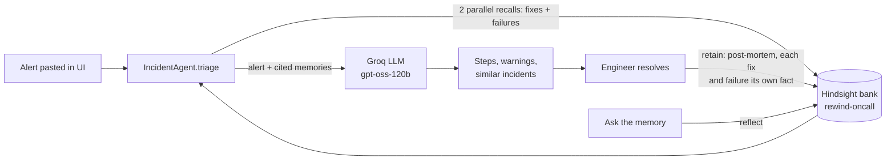

# Rewind

**An on-call agent that remembers what fixed an incident, and what made it worse.**

When you get paged at 3am, the answer is usually somewhere in a post-mortem nobody re-reads. Rewind pastes the alert into memory instead. It recalls how similar incidents were resolved, cites them, and warns you away from fixes that backfired last time:

> **Don't do this: it failed before.** Restarting all payments-api pods at once during INC-2041 made every pod reconnect together, hit `max_connections`, and turned a partial outage into a 20-minute cascade.

Every incident you close teaches it something. The fixes that worked *and* the ones that failed are written to [Hindsight](https://github.com/vectorize-io/hindsight) memory, so the next page on the same service gets a sharper answer.

## The before / after

| | Memory off | Memory on |
|---|---|---|
| Alert: `HikariPool-1 - Connection is not available` on payments-api | "Check recent deploys, look at DB metrics, consider restarting the service." | "This matches INC-2041 and INC-2067. Last time a deploy pushed replicas × pool size past `max_connections`; scaling back to 8 replicas fixed it in 4 minutes. **Do not restart all pods at once**: that caused a 20-minute cascade." |

The memory toggle in the UI lets you show both answers side by side.

## How Hindsight is used

All memory code lives in [`app/memory.py`](app/memory.py).



| Hindsight call | Where | What it does in Rewind |
|---|---|---|
| `create_bank` | `IncidentMemory.ensure_bank` | Creates the `rewind-oncall` bank with a mission (prefer evidence from past incidents, always warn about harmful actions) and a skeptical disposition. |
| `retain` | `IncidentMemory.retain_resolution` | On every resolved incident, stores one post-mortem in which **every fix that worked and every fix that failed is its own self-contained sentence** (service, incident id, outcome), so Hindsight extracts each one as a separate fact. Failures are worded as warnings ("Do not repeat this for a similar alert on payments-api") so they are as easy to recall as successes. The retain carries the incident timestamp, so temporal search works ("last month"), and is queued with `retain_async` so Hindsight's worker paces it under LLM rate limits. |
| `recall` | `IncidentMemory.recall_for_alert` | Runs two recalls in parallel for every alert: one for *what resolved incidents like this*, one for *what failed or made things worse*. Results are merged, deduplicated, labelled fix / failure / context, and numbered M1…Mn so the LLM must cite them. |
| `reflect` | `IncidentMemory.ask` | Powers the **Ask the memory** tab: open questions like "What keeps breaking in payments-api?" are answered by Hindsight's agentic loop over the whole bank. |

The design decision that makes this work: **a failed fix is its own fact.** Buried in a long narrative, "we tried restarting and it got worse" is easy for retrieval to miss. Written as a standalone warning that names the service and the incident, it is extracted as its own fact and comes back every time a similar alert fires. Writing the whole post-mortem in one retain keeps it to one LLM extraction call per incident.

## Run it

You need Python 3.11+, Docker Desktop, and a free [Groq API key](https://console.groq.com/keys).

**Windows shortcut:** double-click `setup.bat` once, put your key in `.env`, then double-click `start.bat`. It starts Hindsight (with Docker if Docker Desktop is running, otherwise natively), loads the history on first run, and opens Rewind.

**1. Configure**

```powershell
# Windows (PowerShell)
python -m venv .venv
.venv\Scripts\activate
pip install -r requirements.txt
copy .env.example .env      # then put your GROQ_API_KEY in .env
```

```bash
# macOS / Linux
python3 -m venv .venv && source .venv/bin/activate
pip install -r requirements.txt
cp .env.example .env        # then put your GROQ_API_KEY in .env
```

**2. Start Hindsight (self-hosted)**

```bash
docker compose up -d
```

The API runs on http://localhost:8888 and Hindsight's own UI on http://localhost:9999 (handy for showing the stored memories and entity graph in a demo). The first pull is large, about 9 GB, because the image bundles local embedding and reranking models.

**3. Load two months of incident history**

```bash
python scripts/seed_memory.py
```

This retains 10 realistic past incidents across payments-api, orders-worker, auth-service, checkout-web, search-api and notifications, including 8 fixes that failed or backfired.

On a free Groq key, Hindsight extracts facts at about 8,000 tokens per minute, so loading the 10 post-mortems takes several minutes. The script waits and shows progress.

**4. Start Rewind**

```bash
uvicorn app.main:app --reload
```

Open http://localhost:8000.

## Demo script (about 3 minutes)

1. **The problem.** Click the *payments-api pool exhausted* sample, switch **Memory off**, click **Analyze**. You get generic advice, often including the risky "restart the service".
2. **The fix.** Switch **Memory on**, analyze the same alert. Rewind cites INC-2041 and INC-2067, recommends scaling back replicas, and puts *restarting all pods* in the red **Don't do this** box. Hover a citation (M2) to see the memory it came from.
3. **It learns.** Click the *billing-cron stuck (no history)* sample. Memory has nothing, and says so. Fill in the resolve form (root cause: *invoice job requests 12Gi, no node has room after node pool shrink*; worked: *lowered request to 4Gi and moved job to batch node pool*; failed: *deleted the pending job, the CronJob recreated it in the same state*). Click **Save to memory**.
4. **Ask it again.** Paste the same billing-cron alert. This time Rewind recalls the fix you just taught it and warns against deleting the job.
5. **Reflect.** Open **Ask the memory** and ask *"Which fixes have made incidents worse?"*

## Project layout

```
app/
  main.py         FastAPI routes + lifespan wiring
  agent.py        Triage prompt, citation checking, resolve flow
  memory.py       Hindsight retain / recall / reflect wrapper
  llm.py          Groq client with JSON-mode → retry → fallback-model chain
  store.py        Local JSON log of incidents for the sidebar
  models.py       Pydantic models
  static/index.html   Single-page console (no build step)
data/
  seed_incidents.json   Past incidents loaded into memory
  demo_alerts.json      Sample alerts for the UI
scripts/seed_memory.py  Seeds the Hindsight bank
docker-compose.yml      Self-hosted Hindsight with Groq
tests/                  Pytest suite (no network needed)
```

## Robustness

- **LLM errors.** Open models occasionally fail structured output. `llm.py` tries JSON mode, then plain mode, then the fallback model (`qwen/qwen3-32b`), and parses replies loosely (strips `<think>` blocks, code fences, trailing commas).
- **LLM down.** Triage still returns what memory recalled, labelled as fixes and warnings, with a banner saying the model was unavailable.
- **LLM rate limits.** Memory writes are queued in Hindsight's background worker (`retain_async`), which paces fact extraction under free-tier token limits instead of dropping writes.
- **Hindsight down.** Triage continues without memory instead of failing the page; saving a resolution reports the error and keeps the incident open so you can retry.
- **Hallucinated citations.** Sources that don't match a recalled memory, and incident ids that don't appear in memory, are dropped before the result reaches the UI.

## Tests

```bash
pip install -r requirements-dev.txt
pytest -q
```

The suite fakes both Hindsight and the LLM, so it runs offline.

## Configuration

All settings come from `.env` (see `.env.example`): `GROQ_API_KEY`, `LLM_MODEL`, `LLM_FALLBACK_MODEL`, `HINDSIGHT_URL`, `HINDSIGHT_BANK_ID`, `HINDSIGHT_LLM_MODEL`, `RECALL_MAX_TOKENS`, `RECALL_BUDGET`.

To use Hindsight Cloud instead of Docker, set `HINDSIGHT_URL` to your cloud endpoint and `HINDSIGHT_API_KEY` to your key.

## Links

- [Hindsight on GitHub](https://github.com/vectorize-io/hindsight)
- [Hindsight documentation](https://hindsight.vectorize.io/)
- [What is agent memory?](https://vectorize.io/what-is-agent-memory)
