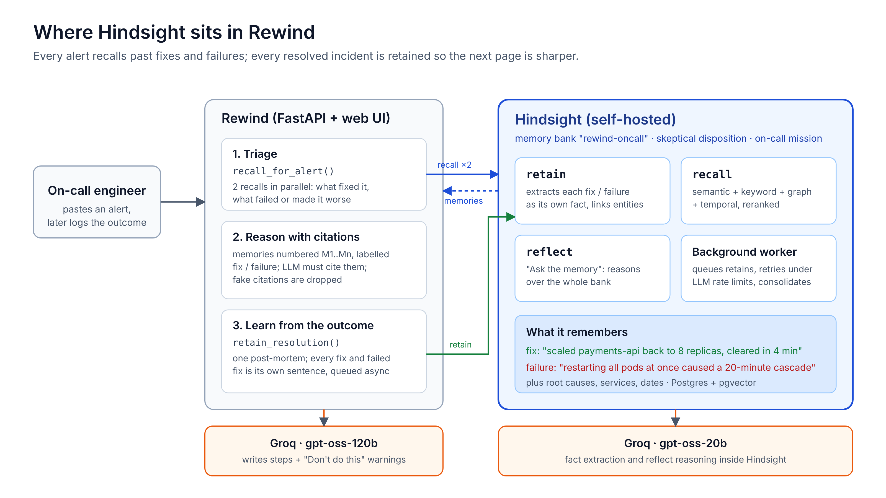
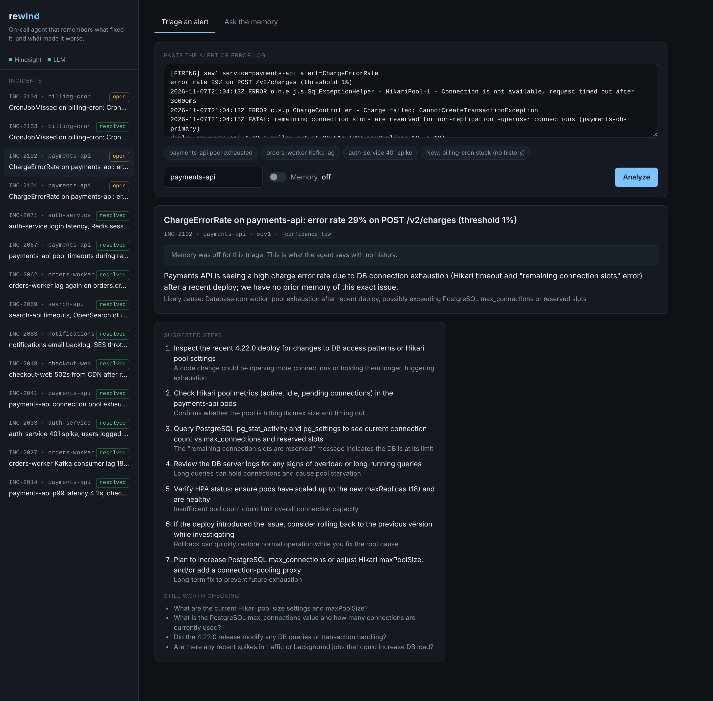
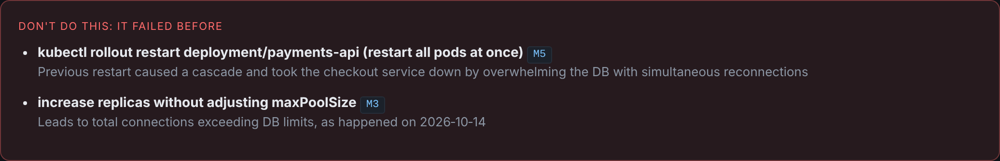
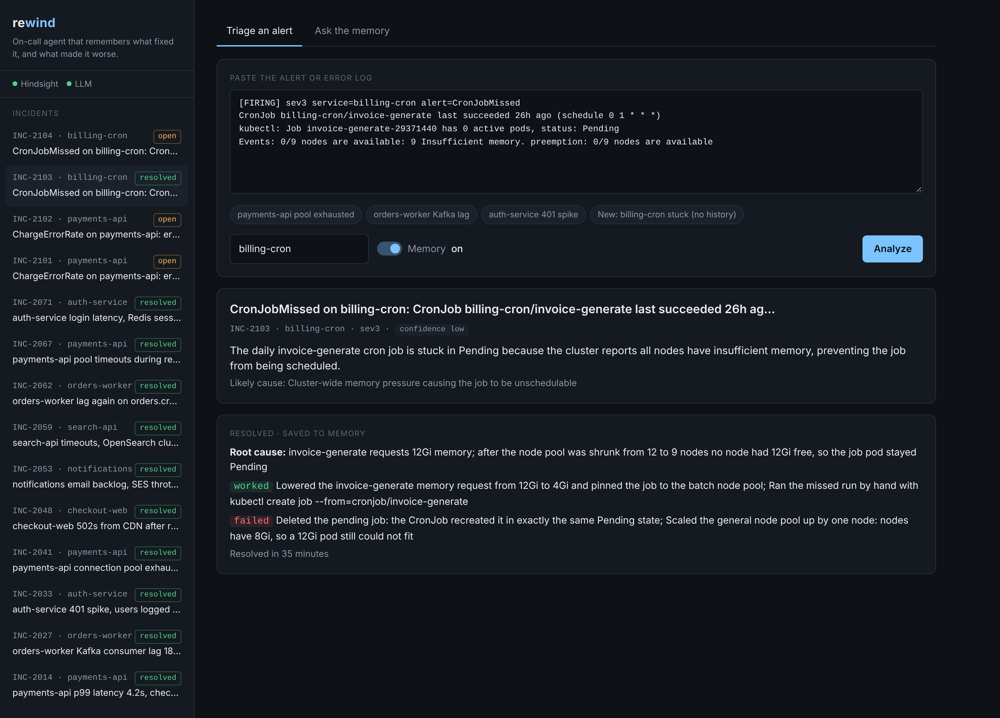
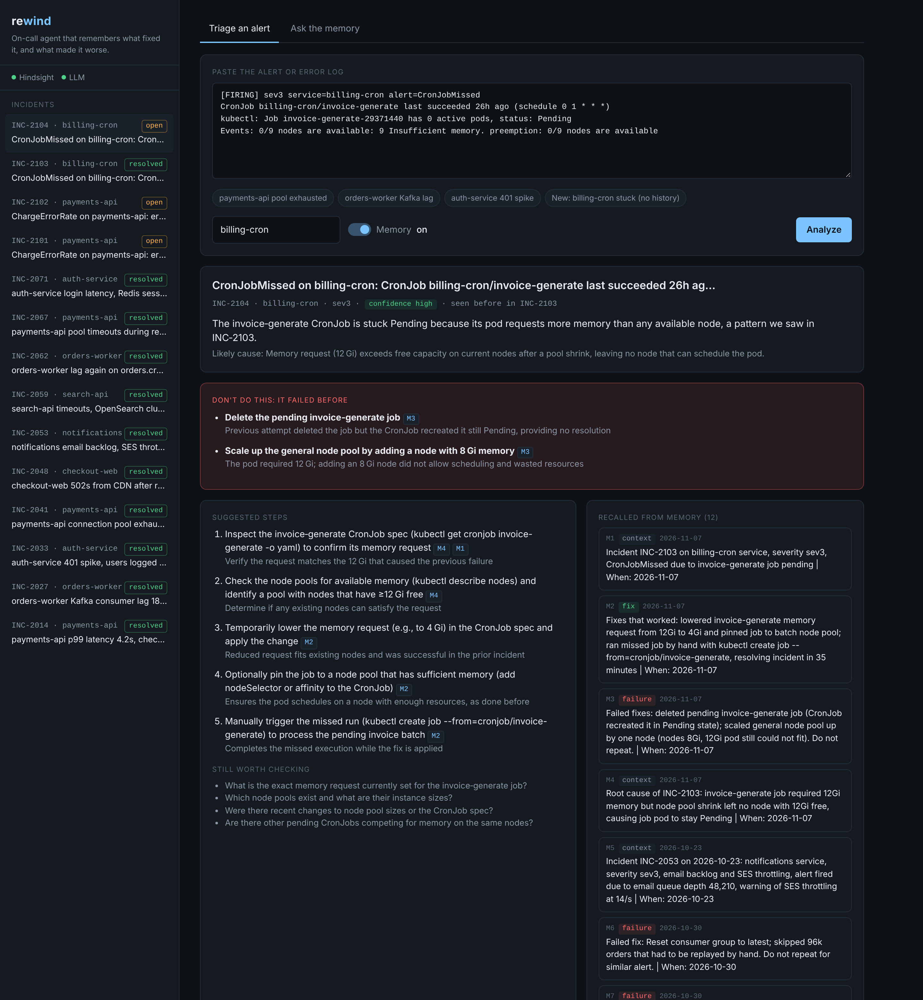

The most useful sentence my incident agent has produced so far is a warning: *don't restart all the payments-api pods at once, because last time that turned a partial outage into a 20-minute cascade.*

No model knows that out of the box, and it's rarely in a runbook. Knowledge like that is learned the hard way during an outage, written into a post-mortem, and then nobody reads the post-mortem again. I built **Rewind** so the next person paged at 3am doesn't have to relearn it.

Rewind is an on-call agent with long-term memory. You paste an alert, and it recalls how similar incidents were resolved. It also recalls which "fixes" backfired, and it warns you away from them before you try them. When the incident is over, you tell it what actually happened, and it remembers that too.

## What it does and how it fits together

The stack is deliberately small:

- **FastAPI** backend and a single-page console with no build step.
- **[Hindsight](https://github.com/vectorize-io/hindsight)**, self-hosted, as the memory layer: one memory bank called `rewind-oncall`.
- **Groq**: `gpt-oss-120b` writes the triage, and `gpt-oss-20b` does fact extraction inside Hindsight.



The flow has three steps:

1. **Triage.** The alert goes to Hindsight as two recall queries run in parallel. One asks what fixed incidents like this, and the other asks what failed or made them worse.
2. **Reason with citations.** Recalled memories are numbered M1..Mn and labelled *fix*, *failure* or *context*. The LLM must cite them, and any citation that doesn't match a recalled memory is dropped.
3. **Learn.** When the engineer closes the incident, Rewind retains a post-mortem: root cause, what worked, and what didn't.

I chose Hindsight over a plain vector store because recall is not just embeddings. It runs semantic, keyword, graph and temporal search in parallel and reranks the results, and its docs explain [how agent memory differs from RAG](https://hindsight.vectorize.io/developer/rag-vs-hindsight). For incidents that matters: "HikariPool-1 connection timeout" needs keyword matching, "the payments outage three weeks ago" needs time, and "payments-db-primary" links facts across incidents.

## The core idea: failures are first-class memories

Most incident tooling remembers what worked. That's half the story. The expensive mistakes during an outage are the confident, plausible actions that make it worse: restarting everything, flushing a cache, purging the whole CDN, resetting a consumer group.

So Rewind writes every failed fix as its own self-contained sentence. Each one names the service and the incident and is worded as a warning:

```python
def failure_text(incident: Incident, res: Resolution, bad: str) -> str:
    return (
        f"Failed fix during {incident.service} incident {incident.id}: {bad.rstrip('.')}. "
        f"Do not repeat this for a similar alert on {incident.service}."
    )
```

Buried in a long narrative, "we tried restarting and it got worse" is easy for retrieval to miss. Written as a standalone sentence, Hindsight extracts it as its own fact, links it to the `payments-api` entity, and returns it whenever a similar alert fires.

Recall then asks for failures explicitly, instead of hoping they show up among the fixes:

```python
queries = [
    f"Past incidents similar to this alert {where} and the fixes that resolved them: {alert}",
    f"Fixes that failed or made things worse for incidents like this {where}: {alert}",
]
responses = await asyncio.gather(
    *(
        self.client.arecall(
            bank_id=self.bank_id,
            query=q,
            max_tokens=self.recall_max_tokens,
            budget=self.recall_budget,
        )
        for q in queries
    ),
    return_exceptions=True,
)
```

Two details matter here. `max_tokens` budgets the context in tokens, not in result counts, so I always know how much of the prompt memory will take. `return_exceptions=True` means a slow recall degrades the answer instead of failing the page.

## Before and after, on the same alert

I loaded ten post-mortems into the bank (payments, orders, auth, checkout, search, notifications) and pasted this alert:

```
[FIRING] sev1 service=payments-api alert=ChargeErrorRate
error rate 29% on POST /v2/charges
HikariPool-1 - Connection is not available, request timed out after 30000ms
FATAL: remaining connection slots are reserved ... (payments-db-primary)
deploy payments-api 4.22.0 rolled out at 20:51Z (HPA maxReplicas 10 -> 18)
```

**With memory off**, the agent was reasonable but generic. It said "we have no prior memory of this exact issue". Its steps included *"verify HPA status: ensure pods have scaled up to the new maxReplicas (18)"* and *"consider rolling back"*. Scaling up was exactly the cause the last time this happened.



**With memory on**, the same model gave a different answer. It recognised INC-2041 and INC-2067 and named the likely cause: replicas × maxPoolSize exceeding `max_connections`. Its first warning:



The steps also changed. Check replicas × pool size, lower `maxPoolSize` from 20 to 12, scale back to 8 replicas if that isn't enough. Each step cites the memory it came from, and the console highlights that memory when you hover a citation.

## Watching it learn

The second test was an alert Rewind had never seen: a `billing-cron` job stuck in Pending with "Insufficient memory". Memory had nothing on billing-cron, so the agent gave generic Kubernetes advice at **low confidence**.

I closed the incident with what actually happened. The root cause was a 12Gi memory request after the node pool shrank. Lowering it to 4Gi and pinning the job to the batch pool worked. Two things didn't: deleting the pending job (the CronJob just recreated it) and adding a node (nodes have 8Gi, so a 12Gi pod still can't fit).



A couple of minutes later, once Hindsight had processed it, I pasted the same alert again. Confidence was **high**, the alert was tagged "seen before in INC-2103", the fix that worked came first, and both failed attempts sat in the red box:



That is the whole point of the project in one loop: one resolution, and the next engineer starts where the last one finished.

## Keeping the model honest

An agent that cites memory is only useful if the citations are real. Open models occasionally invent them, so I validate everything against what was recalled:

```python
valid_refs = {m.ref for m in memories}
...
known_ids = {i for m in memories for i in _INCIDENT_ID.findall(m.text)}
similar = [str(i) for i in _as_list(raw.get("similar_incidents")) if str(i) in known_ids]
```

If the model mentions INC-9999 and no recalled memory contains it, the console never shows it.

## Lessons learned

**1. Store what went wrong as deliberately as what went right.** The "Don't do this" box is the most useful part of every answer. It only works because failures are written as standalone warnings, not as a footnote in a post-mortem.

**2. Write memories for retrieval, not for humans.** Self-contained sentences that name the service, the incident and the outcome come back reliably. Long narrative paragraphs don't.

**3. Budget for the LLM behind your memory, not just the one in front of it.** This was the painful one. Hindsight uses an LLM to extract facts on every retain. On Groq's free tier (8K tokens a minute, 200K a day), my first version retained 3–4 memories per incident and hit both limits while loading history. I switched to one retain per incident, with every fix and failure as its own sentence inside it, and queued writes with `retain_async=True` so Hindsight's worker paces and retries them. It cost one LLM call per incident instead of four, with no loss in recall quality that I could see.

**4. Validate citations in code, not in the prompt.** Telling the model "only cite memories you were given" helps. Dropping the ones it made up is what you can rely on.

**5. Hindsight stores facts in its own words, so match ideas, not strings.** Hindsight rewrites what you give it into fact sentences: "the outage got worse" came back as "causing a 20-minute cascade". My fix/failure labels started as exact-phrase matches and missed paraphrases until I broadened them. The LLM still sees the full fact text, so a wrong label degrades gracefully, but the label is what users scan.

## Try it

The code is a small Python project: FastAPI, the Hindsight Python client, and one HTML file. It runs locally with a self-hosted Hindsight. If you're building anything where an agent should get better at a job over time, start with the [Hindsight documentation](https://hindsight.vectorize.io/) and read Vectorize's explainer on [what agent memory is](https://vectorize.io/what-is-agent-memory). Then ask yourself what your agent's "restart all the pods" moment is, and make sure it remembers it.


---

Code: [github.com/Kavin763/rewind](https://github.com/Kavin763/rewind)
